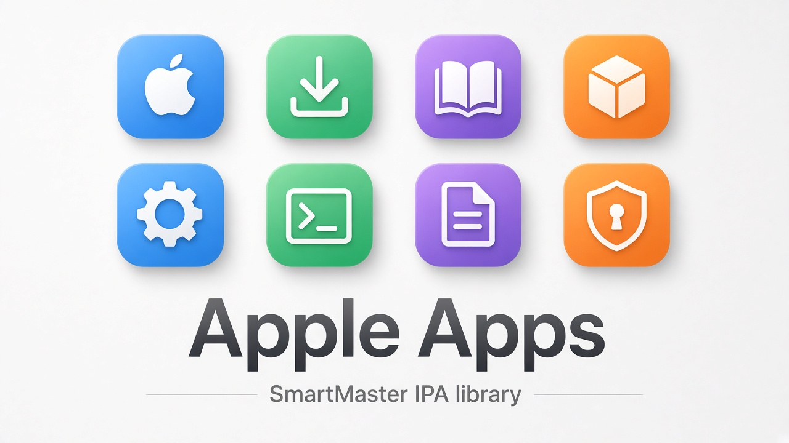

<p align="center">
  
</p>

<h1 align="center">Apple Apps</h1>

<p align="center">
  <b>Витрина IPA в стиле App Store</b><br>
  TrollStore · Sideloadly · AltServer · Scarlet
</p>

<p align="center">
  <a href="https://smartmaster35rus-dev.github.io/Apple-Apps/"></a>
  <a href="https://github.com/smartmaster35rus-dev/Apple-Apps/releases/tag/ipa"></a>
  <a href="https://smartmaster35rus-activator.ru/app-install/sideload"></a>
</p>

<p align="center">
  <a href="https://smartmaster35rus-dev.github.io/Apple-Apps/">Открыть витрину</a> ·
  <a href="https://github.com/smartmaster35rus-dev/Apple-Apps/releases/tag/ipa">Releases</a> ·
  <a href="https://t.me/SmartMaster35Rus">Telegram</a> ·
  <a href="https://smartmaster35rus-activator.ru/">SmartMaster</a>
</p>

---

## Как устроено

IPA **не лежат в git**. Каталог и иконки — в репозитории, сами файлы — в **GitHub Releases** (тег `ipa`).

Новые файлы: положи `.ipa` в тот же релиз `ipa` и добавь строку в [`docs/apps.json`](docs/apps.json) или через админку **IPA для клиентов**.

```
https://github.com/smartmaster35rus-dev/Apple-Apps/releases/download/ipa/<файл>.ipa
```

Лимит GitHub: **2 ГБ на файл**.

---

## Apps (33)

| # | Приложение | Версия | Категория | GET |
|--:|------------|--------|-----------|-----|
| 1 | СберБанк Онлайн | 17.6.1 | Банки | [sberbank_v17.6.1.ipa](https://github.com/smartmaster35rus-dev/Apple-Apps/releases/download/ipa/sberbank_v17.6.1.ipa) |
| 2 | Т-Банк | 8.2.6 | Банки | [t-bank_v8.2.6.ipa](https://github.com/smartmaster35rus-dev/Apple-Apps/releases/download/ipa/t-bank_v8.2.6.ipa) |
| 3 | Т-Банк 7.13 | 7.13.1 | Банки | [t-bank-713_v7.13.1.ipa](https://github.com/smartmaster35rus-dev/Apple-Apps/releases/download/ipa/t-bank-713_v7.13.1.ipa) |
| 4 | ВТБ | 3.2.1 | Банки | [vtb_v3.2.1.ipa](https://github.com/smartmaster35rus-dev/Apple-Apps/releases/download/ipa/vtb_v3.2.1.ipa) |
| 5 | ВТБ (Сириус) | 2.0.1 | Банки | [vtb-sirius_v2.0.1.ipa](https://github.com/smartmaster35rus-dev/Apple-Apps/releases/download/ipa/vtb-sirius_v2.0.1.ipa) |
| 6 | Альфа-Банк (А-Ключ) | 2.0.0 | Банки | [alfa-a-kluch_v2.0.0.ipa](https://github.com/smartmaster35rus-dev/Apple-Apps/releases/download/ipa/alfa-a-kluch_v2.0.0.ipa) |
| 7 | Газпромбанк | 5.6.0 | Банки | [gazprombank_v5.6.0.ipa](https://github.com/smartmaster35rus-dev/Apple-Apps/releases/download/ipa/gazprombank_v5.6.0.ipa) |
| 8 | МТС Банк | 11.0.0 | Банки | [mts-bank_v11.0.0.ipa](https://github.com/smartmaster35rus-dev/Apple-Apps/releases/download/ipa/mts-bank_v11.0.0.ipa) |
| 9 | Совкомбанк | 1.1.1 | Банки | [sovcombank_v1.1.1.ipa](https://github.com/smartmaster35rus-dev/Apple-Apps/releases/download/ipa/sovcombank_v1.1.1.ipa) |
| 10 | Россельхозбанк | 1.0.7 | Банки | [rosselkhozbank_v1.0.7.ipa](https://github.com/smartmaster35rus-dev/Apple-Apps/releases/download/ipa/rosselkhozbank_v1.0.7.ipa) |
| 11 | СберKids | 5.12.0 | Банки | [sberkids_v5.12.0.ipa](https://github.com/smartmaster35rus-dev/Apple-Apps/releases/download/ipa/sberkids_v5.12.0.ipa) |
| 12 | ЮMoney | 11.12.0 | Финансы | [yoomoney_v11.12.0.ipa](https://github.com/smartmaster35rus-dev/Apple-Apps/releases/download/ipa/yoomoney_v11.12.0.ipa) |
| 13 | Яндекс Пэй | 0.234.4 | Финансы | [yandex-pay_v0.234.4.ipa](https://github.com/smartmaster35rus-dev/Apple-Apps/releases/download/ipa/yandex-pay_v0.234.4.ipa) |
| 14 | АЗС Татнефть | 2.12.0 | АЗС | [azs-tatneft_v2.12.0.ipa](https://github.com/smartmaster35rus-dev/Apple-Apps/releases/download/ipa/azs-tatneft_v2.12.0.ipa) |
| 15 | АЗС Газпромнефть | 1.1.1 | АЗС | [azs-gazpromneft_v1.1.1.ipa](https://github.com/smartmaster35rus-dev/Apple-Apps/releases/download/ipa/azs-gazpromneft_v1.1.1.ipa) |
| 16 | Teboil | 1.6.4 | АЗС | [teboil_v1.6.4.ipa](https://github.com/smartmaster35rus-dev/Apple-Apps/releases/download/ipa/teboil_v1.6.4.ipa) |
| 17 | ЛУКОЙЛ | 4.10.3 | АЗС | [lukoil_v4.10.3.ipa](https://github.com/smartmaster35rus-dev/Apple-Apps/releases/download/ipa/lukoil_v4.10.3.ipa) |
| 18 | ВКонтакте | 8.183 | Соцсети | [vk_v8.183.ipa](https://github.com/smartmaster35rus-dev/Apple-Apps/releases/download/ipa/vk_v8.183.ipa) |
| 19 | VK Video | 8.183 | Медиа | [vk-video_v8.183.ipa](https://github.com/smartmaster35rus-dev/Apple-Apps/releases/download/ipa/vk-video_v8.183.ipa) |
| 20 | VK Музыка+ | 8.44 | Медиа | [vk-music_v8.44.ipa](https://github.com/smartmaster35rus-dev/Apple-Apps/releases/download/ipa/vk-music_v8.44.ipa) |
| 21 | VK Mail | 3.92.0 | Соцсети | [vk-mail_v3.92.0.ipa](https://github.com/smartmaster35rus-dev/Apple-Apps/releases/download/ipa/vk-mail_v3.92.0.ipa) |
| 22 | VK Play | 3.16.16 | Игры | [vk-play_v3.16.16.ipa](https://github.com/smartmaster35rus-dev/Apple-Apps/releases/download/ipa/vk-play_v3.16.16.ipa) |
| 23 | VK Знакомства | 1.33 | Соцсети | [vk-dating_v1.33.ipa](https://github.com/smartmaster35rus-dev/Apple-Apps/releases/download/ipa/vk-dating_v1.33.ipa) |
| 24 | MAX | 26.17.3 | Соцсети | [max_v26.17.3.ipa](https://github.com/smartmaster35rus-dev/Apple-Apps/releases/download/ipa/max_v26.17.3.ipa) |
| 25 | Одноклассники | 11.63.1 | Соцсети | [ok_v11.63.1.ipa](https://github.com/smartmaster35rus-dev/Apple-Apps/releases/download/ipa/ok_v11.63.1.ipa) |
| 26 | OK Знакомства | 1.7 | Соцсети | [ok-dating_v1.7.ipa](https://github.com/smartmaster35rus-dev/Apple-Apps/releases/download/ipa/ok-dating_v1.7.ipa) |
| 27 | Spotify+ | 9.1.66 | Медиа | [spotify-plus_v9.1.66.ipa](https://github.com/smartmaster35rus-dev/Apple-Apps/releases/download/ipa/spotify-plus_v9.1.66.ipa) |
| 28 | Яндекс Музыка | 8.09 | Медиа | [ya-music_v8.09.ipa](https://github.com/smartmaster35rus-dev/Apple-Apps/releases/download/ipa/ya-music_v8.09.ipa) |
| 29 | Дзен | 26.6.3 | Медиа | [dzen_v26.6.3.ipa](https://github.com/smartmaster35rus-dev/Apple-Apps/releases/download/ipa/dzen_v26.6.3.ipa) |
| 30 | RUTUBE | 1.2 | Медиа | [rutube_v1.2.ipa](https://github.com/smartmaster35rus-dev/Apple-Apps/releases/download/ipa/rutube_v1.2.ipa) |
| 31 | Маруся | 1.81.0 | Сервисы | [marusya_v1.81.0.ipa](https://github.com/smartmaster35rus-dev/Apple-Apps/releases/download/ipa/marusya_v1.81.0.ipa) |
| 32 | Юла | 6.0 | Сервисы | [youla_v6.0.ipa](https://github.com/smartmaster35rus-dev/Apple-Apps/releases/download/ipa/youla_v6.0.ipa) |
| 33 | Duolingo Max | 7.147.1 | Образование | [duolingo-max_v7.147.1.ipa](https://github.com/smartmaster35rus-dev/Apple-Apps/releases/download/ipa/duolingo-max_v7.147.1.ipa) |

---

## Имена файлов в релизе

| Приложение | Файл |
|------------|------|
| СберБанк Онлайн | `sberbank_v17.6.1.ipa` |
| Т-Банк | `t-bank_v8.2.6.ipa` |
| Т-Банк 7.13 | `t-bank-713_v7.13.1.ipa` |
| ВТБ | `vtb_v3.2.1.ipa` |
| ВТБ (Сириус) | `vtb-sirius_v2.0.1.ipa` |
| Альфа-Банк (А-Ключ) | `alfa-a-kluch_v2.0.0.ipa` |
| Газпромбанк | `gazprombank_v5.6.0.ipa` |
| МТС Банк | `mts-bank_v11.0.0.ipa` |
| Совкомбанк | `sovcombank_v1.1.1.ipa` |
| Россельхозбанк | `rosselkhozbank_v1.0.7.ipa` |
| СберKids | `sberkids_v5.12.0.ipa` |
| ЮMoney | `yoomoney_v11.12.0.ipa` |
| Яндекс Пэй | `yandex-pay_v0.234.4.ipa` |
| АЗС Татнефть | `azs-tatneft_v2.12.0.ipa` |
| АЗС Газпромнефть | `azs-gazpromneft_v1.1.1.ipa` |
| Teboil | `teboil_v1.6.4.ipa` |
| ЛУКОЙЛ | `lukoil_v4.10.3.ipa` |
| ВКонтакте | `vk_v8.183.ipa` |
| VK Video | `vk-video_v8.183.ipa` |
| VK Музыка+ | `vk-music_v8.44.ipa` |
| VK Mail | `vk-mail_v3.92.0.ipa` |
| VK Play | `vk-play_v3.16.16.ipa` |
| VK Знакомства | `vk-dating_v1.33.ipa` |
| MAX | `max_v26.17.3.ipa` |
| Одноклассники | `ok_v11.63.1.ipa` |
| OK Знакомства | `ok-dating_v1.7.ipa` |
| Spotify+ | `spotify-plus_v9.1.66.ipa` |
| Яндекс Музыка | `ya-music_v8.09.ipa` |
| Дзен | `dzen_v26.6.3.ipa` |
| RUTUBE | `rutube_v1.2.ipa` |
| Маруся | `marusya_v1.81.0.ipa` |
| Юла | `youla_v6.0.ipa` |
| Duolingo Max | `duolingo-max_v7.147.1.ipa` |

---

## GitHub Pages

Settings → Pages → **Deploy from a branch** → `main` / `/docs`.

**https://smartmaster35rus-dev.github.io/Apple-Apps/**

---

## Контакты

Вологда, Осановский проезд 33 · [+7 999 988-81-58](tel:+79999888158) · [Telegram](https://t.me/SmartMaster35Rus)
